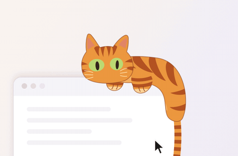
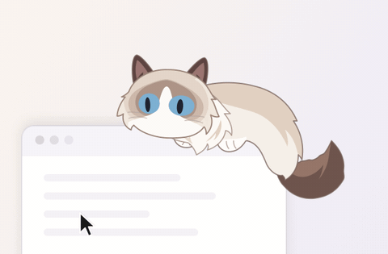
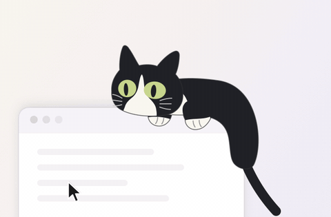
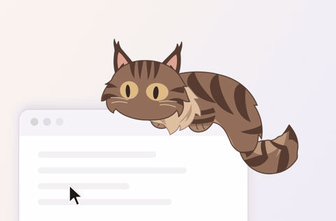

# meltycat

[简体中文](README.zh-CN.md)

meltycat is a desktop cat that melts onto the upper-right corner of your active window. It watches your pointer, dozes off when you go quiet, goes hunting when you shake the mouse, and comes in nine skins, plus any you make yourself.

| Platform | Status |
| --- | --- |
| Windows 10 / 11 (x64) | Available |
| macOS 11+ (Apple Silicon and Intel) | Available |

## Preview

<table>
  <tr>
    <td align="center"> Watching the pointer · Orange Tabby</td>
    <td align="center"> Hunt, Level 1: round pupils · Ragdoll</td>
  </tr>
  <tr>
    <td align="center"> Hunt, Level 3: chattering in Morse code · Tuxedo</td>
    <td align="center"> Dozing off · Maine Coon</td>
  </tr>
</table>

## Features

- The cat lies on the top-right corner of the active window and moves with it when you switch windows, arriving and leaving in a soft poof. It steps away while you drag a window, and wherever it has no corner to lie on.
- It follows the pointer with its eyes, blinks, and sways its tail. Leave the computer alone for a few seconds and it dozes off with its cheek on the ledge, sometimes tucking its paws in, and floats a few Zs.
- Shake the pointer quickly and it goes hunting. At first only its pupils turn round. Keep shaking and it braces on the ledge with its tail tense, then starts chattering and spells out what it wants in Morse code.
- Stroke its head, body, or paws slowly with the pointer and it squints with pleasure, with a heart or a note now and then.
- Nine built-in skins. Longhair: Ragdoll, Ragdoll Mix, Maine Coon, and Siberian. Shorthair: Orange Tabby, Black, Li Hua, Tuxedo, and Uni.
- Make a skin of your own cat. In **Change Skin…**, click **Copy AI Guide**, send the guide and a photo of your cat to an AI assistant, and import the `.meltycat` file it gives you. The format is described in [skins/AI-GUIDE.md](skins/AI-GUIDE.md).
- 15 interface languages. The first launch follows your system language, and your skin and language choices are remembered.

## Download and install

Grab the latest build from the [Releases page](../../releases/latest). Each release includes a `SHA256SUMS.txt` file for verifying downloads.

### Windows

1. Download `meltycat-windows-x64.zip` and extract it to a folder you can write to. Preferences are saved next to the executable, so avoid `Program Files`.
2. Double-click `meltycat.exe`. No installer or extra runtime is needed.
3. The cat appears on your active window, and a cat icon appears in the system tray. If you do not see it, check the hidden icons under the `^` arrow.
4. If Windows SmartScreen shows "Windows protected your PC", click **More info**, then **Run anyway**. The executable is not code-signed.

To uninstall, choose **Exit** from the tray menu and delete the folder. Imported skins are kept in `%APPDATA%\meltycat\skins`, which you can delete too.

### macOS

1. Download `meltycat-macos-universal.zip`, unzip it, and drag `meltycat.app` into **Applications**.
2. On first launch macOS may say the app cannot be verified, because it is not notarized. On macOS 15 or later, open **System Settings > Privacy & Security**, scroll to the Security section, and click **Open Anyway**. On earlier versions, right-click the app and choose **Open**.
3. The cat appears on your active window, and its menu lives in the menu bar. The app does not show a Dock icon.

To uninstall, quit from the menu bar and move `meltycat.app` to the Trash. Imported skins are kept in `~/Library/Application Support/meltycat`, which you can delete too.

## Usage

- **Hunt:** shake the pointer back and forth quickly.
- **Pet:** move the pointer slowly over the cat's head, body, or paws.
- **Sleep:** stop using the mouse and keyboard for a few seconds. Move the mouse or type a little to wake it.
- **Menu:** right-click the tray icon (Windows) or open the menu bar icon (macOS) to change skins, pick a language, or exit.
- **Custom skins:** choose **Change Skin…** from the menu, then drop a `.meltycat` file on the window, click **Choose File…**, or paste the skin text. Double-clicking a `.meltycat` file imports it too. On Windows, launch meltycat once to register the file type for your account. If another app handles these files, use **Open with** and select `meltycat.exe`.

## Build from source

**Windows (x64):** install MSVC C++ Build Tools and a Windows SDK, run `build.cmd`, then open `build\meltycat.exe`.

**macOS:** install Xcode or the Xcode Command Line Tools, run `bash macos/build.sh`, then open `macos/build/meltycat.app`.

## License

Free for personal, educational, and other noncommercial use. You are welcome to modify and share it, but commercial use is not allowed. Licensed under the [PolyForm Noncommercial License 1.0.0](LICENSE), which has the full terms.

## Acknowledgments

Inspired by [KuroCat](https://github.com/chanke17/KuroCat) and [kurocat](https://github.com/qianyiai/kurocat).
