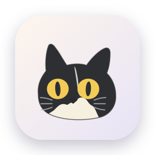

  
  <h1>MeltyCat</h1>
  
MeltyCat is a soft little cat that melts onto the top-right corner of your active window.

  
<a href="README.zh-CN.md">简体中文</a> · <strong>English</strong>

  

    
    
    
    
  

## Preview

<table>
  <tr>
    <td align="center"> Watching · Orange Tabby</td>
    <td align="center"> Hunting · Ragdoll</td>
  </tr>
  <tr>
    <td align="center"> Hunting, for real · Tuxedo</td>
    <td align="center"> Napping · Maine Coon</td>
  </tr>
</table>

## What it does

- **Lounges** on the top-right corner of the window you're using, and moves over when you switch windows.
- **Watches** wherever your pointer goes.
- **Naps** when nothing's going on for a while.
- **Hunts** when you shake the pointer quickly. The longer you shake, the more seriously it takes the job.
- **Likes being petted.** Give it a gentle stroke with the pointer.

There are a few more little details. We'll leave those for you to find!

Nine built-in skins, 15 interface languages.

## Make your own cat

1. Open the menu, choose **Change Skin…**, then click **Copy AI Guide**.
2. Paste the guide into an AI assistant that can read images, and attach photos of your cat. A front view of the face and a side view that shows the markings work best.
3. Drop the `.meltycat` file it gives you onto the Change Skin window, click **Choose File…**, or paste the text. Double-clicking the file works too. On Windows, launch MeltyCat once first so it can register the file type; if another app opens these files, use **Open with** and pick `meltycat.exe`.
4. Not quite right? Send the AI a screenshot of the preview and ask it to compare with the photo.

The skin format is described in [skins/AI-GUIDE.md](skins/AI-GUIDE.md).

## Download and install

Grab the latest build from the [Releases page](../../releases/latest). Each release includes a `SHA256SUMS.txt` file for verifying downloads.

### Windows 10 / 11 (x64)

1. Download `meltycat-windows-x64.zip` and extract it to a folder you can write to. Preferences are saved next to the executable, so avoid `Program Files`.
2. Double-click `meltycat.exe`. No installer or extra runtime is needed.
3. The cat appears on your active window, and a cat icon appears in the system tray. Right-click it to change skins or the language, or to exit. If you do not see the icon, check the hidden icons under the `^` arrow.
4. If Windows SmartScreen shows "Windows protected your PC", click **More info**, then **Run anyway**. The executable is not code-signed.

To uninstall, choose **Exit** from the tray menu and delete the folder. Imported skins are kept in `%APPDATA%\meltycat\skins`, which you can delete too.

### macOS 11+ (Apple silicon and Intel)

1. Download `meltycat-macos-universal.zip`, unzip it, and drag `meltycat.app` into **Applications**.
2. On first launch macOS may say the app cannot be verified, because it is not notarized. On macOS 15 or later, open **System Settings > Privacy & Security**, scroll to the Security section, and click **Open Anyway**. On earlier versions, right-click the app and choose **Open**.
3. The cat appears on your active window, and its menu lives in the menu bar, where you can change skins or the language, or quit. The app does not show a Dock icon.

To uninstall, quit from the menu bar and move `meltycat.app` to the Trash. Imported skins are kept in `~/Library/Application Support/meltycat`, which you can delete too.

## Build from source

**Windows (x64):** install MSVC C++ Build Tools and a Windows SDK, run `build.cmd`, then open `build\meltycat.exe`.

**macOS:** install Xcode or the Xcode Command Line Tools, run `bash macos/build.sh`, then open `macos/build/meltycat.app`.

## License

MeltyCat is open source under the [MIT License](LICENSE). Use it, change it, share it, and make it your own cat.

Made something fun with MeltyCat, or want to work together? Tell us in [Issues](../../issues).

## Acknowledgments

Inspired by [KuroCat](https://github.com/chanke17/KuroCat) and [kurocat](https://github.com/qianyiai/kurocat).
