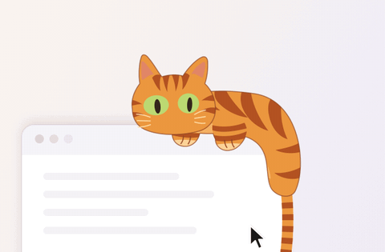
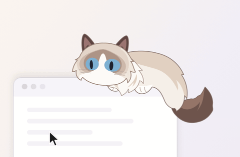
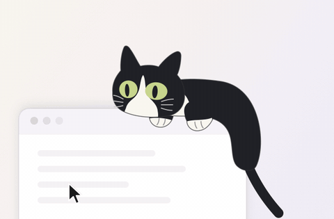
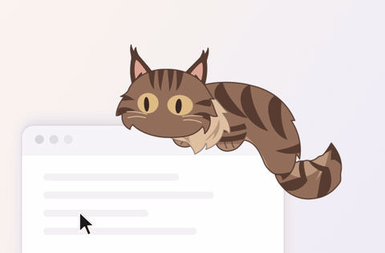

# meltycat

[English](README.md)

meltycat 是一只软软地瘫在当前窗口右上角的桌面猫。它会盯着你的鼠标看，闲下来就打盹，晃晃鼠标它就开始捕猎。自带九种皮肤，也可以照着自家的猫做一套。

| 平台 | 状态 |
| --- | --- |
| Windows 10 / 11（x64） | 已发布 |
| macOS 11+（Apple 芯片和 Intel） | 已发布 |

## 预览

<table>
  <tr>
    <td align="center"> 盯着鼠标 · 橘虎斑</td>
    <td align="center"> 捕猎 Level 1：瞳孔变圆 · 布偶猫</td>
  </tr>
  <tr>
    <td align="center"> 捕猎 Level 3：磕牙打摩斯电码 · 奶牛猫</td>
    <td align="center"> 打盹 · 缅因猫</td>
  </tr>
</table>

## 功能

- 小猫趴在当前窗口的右上角，切换窗口时跟着过去，来去都有一小团软软的“噗”。拖动窗口时，或者窗口没有地方可趴时，它会先躲开。
- 眼睛跟着鼠标转，会眨眼、摇尾巴。几秒钟不碰电脑，它就把脸颊贴在窗沿上打盹，有时把前爪收起来，还会冒几个 Z。
- 快速来回晃动鼠标，它就开始捕猎：先是瞳孔变圆；继续晃，它会撑起上身扒住窗沿，尾巴绷直；再晃下去，它会磕起牙来，用摩斯电码说出它想要什么。
- 用鼠标在它的头、身体或前爪上慢慢划过，它会舒服地眯起眼，时不时冒出爱心或音符。
- 自带九种皮肤。长毛：布偶猫、布偶混血、缅因猫、西伯利亚猫；短毛：橘虎斑、黑猫、狸花猫、奶牛猫、海胆（Uni）。
- 可以把自家的猫做成皮肤：在**换皮肤…**窗口里点**复制 AI 指南**，把指南和猫的照片一起发给 AI 助手，再把它给你的 `.meltycat` 文件导入进来。格式说明见 [skins/AI-GUIDE.md](skins/AI-GUIDE.md)。
- 支持 15 种界面语言。首次启动时跟随系统语言，皮肤和语言选择会自动保存。

## 下载与安装

到 [Releases 页面](../../releases/latest) 下载最新版本。每个版本都附有 `SHA256SUMS.txt`，可用来校验下载文件。

### Windows

1. 下载 `meltycat-windows-x64.zip`，解压到一个有写入权限的文件夹。设置会保存在程序旁边，所以不要放进 `Program Files`。
2. 双击 `meltycat.exe`，无需安装，也不需要额外的运行库。
3. 小猫会出现在当前窗口上，系统托盘里会出现猫图标。如果看不到，请点开任务栏右下角 `^` 下的隐藏图标。
4. 如果 Windows SmartScreen 提示“Windows 已保护你的电脑”，点击**更多信息**，再点**仍要运行**。这个程序没有代码签名。

卸载时，先在托盘菜单里选择**退出 meltycat**，再删除文件夹即可。

### macOS

1. 下载 `meltycat-macos-universal.zip`，解压后把 `meltycat.app` 拖进**应用程序**文件夹。
2. 首次打开时，macOS 可能提示无法验证应用，因为它没有经过公证。macOS 15 及以上版本请打开**系统设置 > 隐私与安全性**，在“安全性”一栏点击**仍要打开**。更早的版本可以右键点击应用，选择**打开**。
3. 小猫会出现在当前窗口上，菜单位于顶部菜单栏，应用不会在 Dock 里显示图标。

卸载时，先在菜单栏里退出，再把 `meltycat.app` 移到废纸篓。导入的皮肤保存在 `~/Library/Application Support/meltycat`，也可以一并删除。

## 使用方法

- **捕猎：** 快速来回晃动鼠标。
- **摸摸：** 在小猫的头、身体或前爪上慢慢移动鼠标。
- **打盹：** 几秒钟不碰鼠标和键盘。动一动鼠标或者敲几下键盘就能叫醒它。
- **菜单：** 右键点击托盘图标（Windows）或点击菜单栏图标（macOS），可以换皮肤、切换语言或退出。
- **自定义皮肤：** 在菜单里选**换皮肤…**，把 `.meltycat` 文件拖进窗口、点**选择文件…**，或者直接粘贴皮肤内容。双击 `.meltycat` 文件也能导入。

## 从源码编译

**Windows（x64）：** 安装 MSVC C++ Build Tools 和 Windows SDK，运行 `build.cmd`，然后打开 `build\meltycat.exe`。

**macOS：** 安装 Xcode 或 Xcode 命令行工具，运行 `bash macos/build.sh`，然后打开 `macos/build/meltycat.app`。

## 许可证

可免费用于个人、学习和其他非商业用途，欢迎修改和分享，但不得用于商业用途。本项目采用 [PolyForm Noncommercial License 1.0.0](LICENSE)，完整条款见该文件。

## 致谢

灵感来自 [KuroCat](https://github.com/chanke17/KuroCat) 和 [kurocat](https://github.com/qianyiai/kurocat)。
